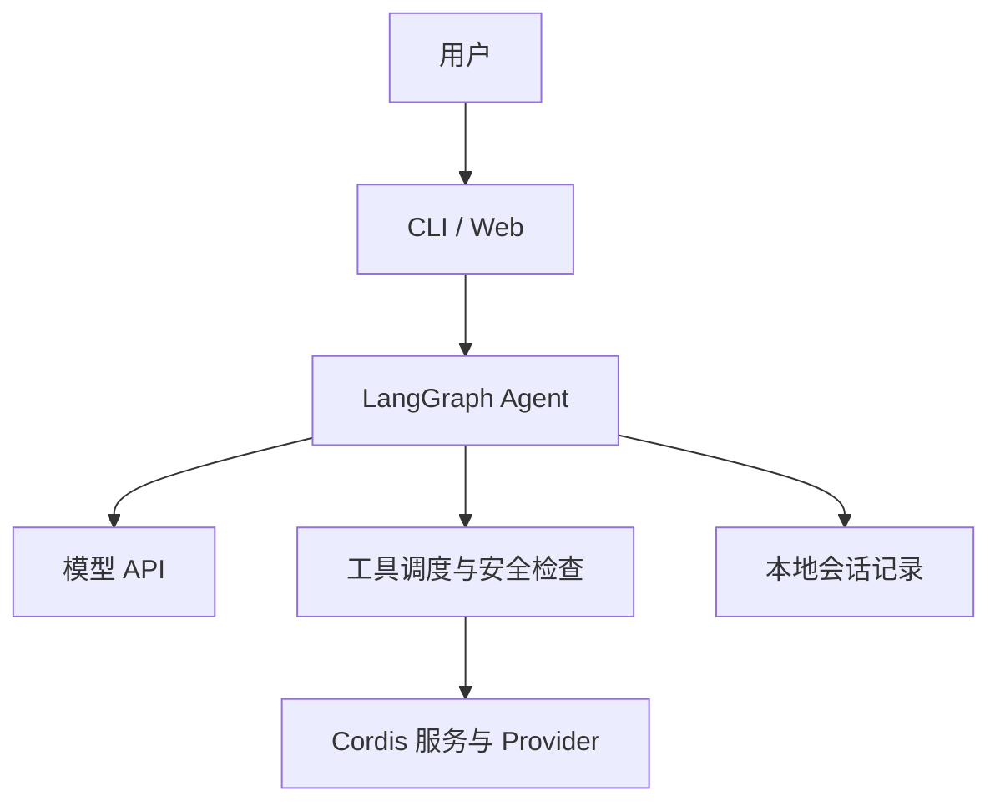
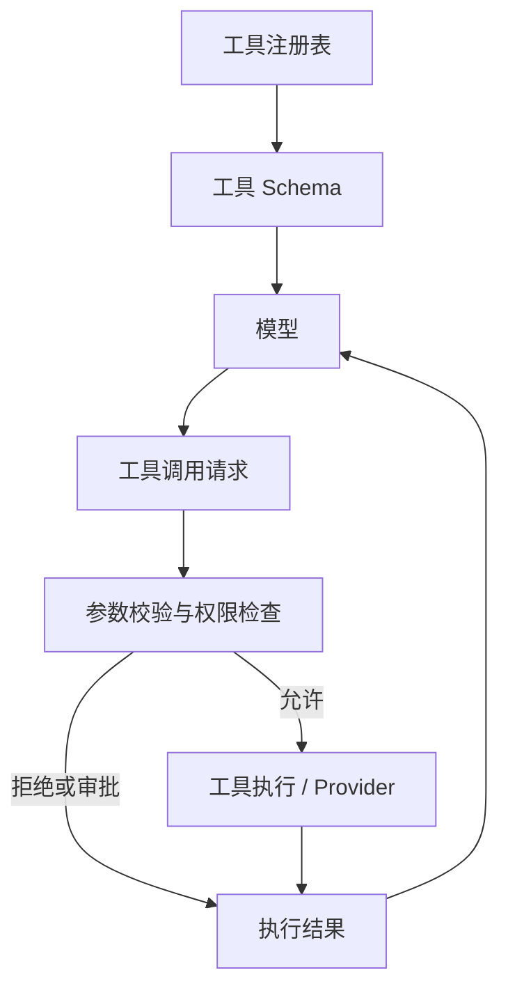

# SecureAgent Harness

SA 是一个基于 LangGraph 的安全增强型 Agent，支持模型工具调用、执行端权限检查和 Docker 隔离测试。

## 环境与安装

需要 Python 3.12+、[uv](https://docs.astral.sh/uv/) 和支持 Chat Completions、Tool Calling 的模型服务。Web 界面需要 Node.js；隔离测试需要 Docker。

```powershell
uv sync
Copy-Item .env.example .env
```

在 `.env` 中填写：

```dotenv
SA_API_KEY=你的模型密钥
SA_MODEL=你的模型名称
SA_BASE_URL=模型服务地址
```

## 运行

```powershell
# CLI
uv run python main.py --workspace G:\你的工作区

# Web 后端
uv run python main_web.py
```

在另一终端启动 Web 前端：

```powershell
cd frontend
npm ci
npm run dev
```

本地 API 默认不提供用户认证，请勿暴露给不受信任的网络。

## 测试

在包含 `tests/` 的开发仓库中运行（公开版本不含测试脚本）：

```powershell
uv run python -m unittest discover -s tests -v
```

## 项目架构



## 工具执行架构



模型提出工具调用，执行端负责授权；需要审批的操作由用户确认。已接入 MCP 客户端；RAG 和跨系统幂等恢复尚未完整实现。
