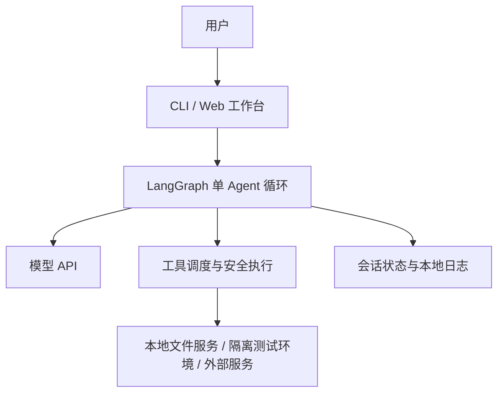
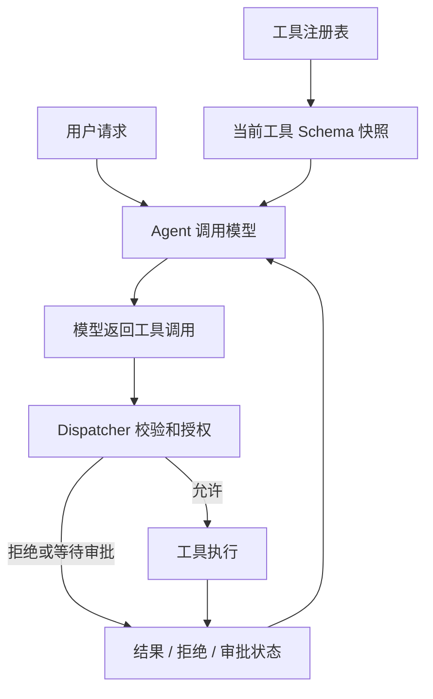

# SecureAgent Harness

SecureAgent Harness（SA）是一个面向通用任务的安全增强型自主智能体项目。当前版本提供单 Agent 对话、模型工具调用、工作区约束和可选的隔离测试环境。

默认单轮不限制模型步骤或工具调用次数。内置可独立卸载的工具监控插件按轮记录调用次数；连续精确重复同一调用时会提醒模型，不强制中止。监控记录在会话的 `plugin/tool-monitor` 事件中（旧记录使用 `tool/monitor`），当前前端未展示此计数，也没有已验证的活动轮次停止功能。

回复风格由人格插件提供，启动前可在 `.env` 设置 `SA_PERSONA=catgirl`（默认，可爱猫娘）、`SA_PERSONA=detective`（工藤新一风格）、`SA_PERSONA=demon`（恶魔小子唐喻琪）或 `SA_PERSONA=none`（不附加人格风格）。未知名称会导致初始化失败。前端顶部可切换已注册的人格或关闭人格；同一工作区内的会话共享选择，未分组会话共享另一份选择，重启后恢复环境变量指定的默认值。人格通过 `ctx.personas` 注册和选择，可信宿主代码可调用 `dispatcher.personas.select(name)` 或 `select(None)`；更改从下一次模型步骤生效。人格只影响模型表达，不替代后端权限与安全检查。

内置插件位于 `src/secureagent/plugins/`：`tools/` 存放工具插件，`prompts/` 中每个人格各有一个文件，`observers/` 存放监控插件；默认插件由 `bootstrap.py` 和 Dispatcher 显式注册，不会自动扫描目录。

工具执行逻辑及对应 schema 主要位于 `src/secureagent/tools/`；`plugins/tools/` 中每个模型可调用工具各有独立插件文件，安装器将工具和必要的规则注册进插件作用域。删除、恢复、转换插件共享回收区状态，但各自独立卸载；卸载审批对应的插件会使其未决审批失效。转换还依赖安全删除的授权规则，该规则不可用时转换会在写入目标前拒绝。Dispatcher 负责装配这些插件和依赖。

可信宿主代码可直接通过分类接口安装插件。插件安装函数的签名为 `(scope, ctx)`；注册接口返回卸载函数：

```python
dispose_prompt = dispatcher.plugins.register_prompt(
    "my-persona", install_persona, dependencies=("personas",)
)
dispose_tool = dispatcher.plugins.register_tool(
    "my-monitor", install_monitor, dependencies=("turn_events",)
)
```

`register_tool` 也用于工具调用监控等工具相关插件；工具插件可通过 `scope.register` 和 `scope.register_rule` 注册工具及规则，提示词插件使用 `ctx.personas.register` 并将返回的注销函数交给 `scope.register_cleanup`。可通过 `plugins.names("prompt")` 或 `plugins.names("tool")` 查询分类，`plugins.unload(name)` 或返回的卸载函数卸载插件。旧的 `plugins.register` 保留用于兼容并按工具类记录。接口分类用于组织和生命周期管理，不限制同进程可信插件的能力；当前没有路径自动发现或不可信插件隔离。

工具注册表通过 Cordis 服务 `ctx.tools` 暴露，插件可声明 `dependencies=("tools",)` 使用其 `register`、`get`、`snapshot` 和 `schemas`。直接调用 `ctx.tools.register` 时，插件必须将返回的注销函数交给 `scope.register_cleanup`，并用 `scope.guard` 保护处理函数；通常建议使用自动接入生命周期的 `scope.register`。每次模型请求都会从同一注册表快照获取工具 schema，执行仍经 Dispatcher 校验和授权；模型并不直接访问 Python 注册表。

系统提示词通过 `ctx.systemPrompt` 按片段注册并在模型请求时组装。可信插件可用 `scope.register_cleanup(ctx.systemPrompt.section(name, text, order=100, required_tool="read_file"))` 绑定片段生命周期；`required_tool` 可选，并依据该次工具快照过滤。基础提示词由 `base-system` 插件提供，缺失时拒绝组装；人格按当前选择附加。当前仅 `read_file` 使用工具插件贡献的动态使用指引，其余原有工具工作流说明仍在基础提示词内。SA 在受管理会话上替换系统消息，而非实现 DSH 的历史追加和停用通知机制；自定义系统消息保持原有行为。

网络工具经 `ctx.web` 调用搜索或抓取提供方。两项工具通过原有 `SA_WEB_SEARCH_ENABLED`、`SA_WEB_FETCH_ENABLED` 分别开启；启用时默认安装 DeepSeek 对应提供方。可选 `SA_WEB_SEARCH_PROVIDER` 与 `SA_WEB_FETCH_PROVIDER` 固定提供方 ID（默认分别为 `deepseek-search-api`、`deepseek-fetch-api`）；留空时只有一个已注册提供方才自动选择，多个或指定项缺失会返回明确错误。配置在服务创建时读取；提供方注册和注销可由可信插件管理，替换 provider 不自动启用模型工具。当前不检查 provider 的异步就绪状态、不支持传递取消信号，也未提供本地 HTTP 抓取 provider。联网工具的校验与授权仍在模型工具执行路径中，不应把直接调用 `ctx.web` 当成经过模型工具授权。

其他工具能力也通过服务接入可信 provider：`ctx.fs` 使用本地文件 provider，`ctx.fileSearch` 使用本地目录搜索 provider，`ctx.skills` 使用本地 Skill provider，`ctx.spillStore` 使用会话本地存储 provider，`ctx.recycle` 使用本地审批与回收 provider，配置测试镜像时 `ctx.testRunner` 使用 Docker 测试 provider。这些服务提供显式注册和注销；Skill、搜索、Spill 和测试服务目前只在恰有一个 provider 时工作，不支持按 ID 配置选择。`ctx.recycle` 同一服务实例只接受一次 provider 注册。目录搜索和回收实现仍是本地语义，尚不支持远程 provider；直接调用这些服务不替代 Dispatcher 的模型工具授权。

`ctx.fs` 同时只允许一个 provider；`SA_FS_PLUGIN` 是宿主插件配置 ID，默认 `fs-provider-local`，并非文件操作的路由参数。可信宿主可先向 `dispatcher.filesystem_plugins.register_factory(id, installer)` 明确登记安装函数，再使用 `reload(id)` 或 `reload_from_environment()` 重载；后者读取当前进程环境，不会自动重新解析 `.env`。重载等待进行中的文件操作，卸载原插件后再安装新插件，并使所有会话的旧读取观察和未决文件审批失效。新插件安装失败时服务保持不可用，需由宿主修复配置并重试。SA 目前只有本地生产 provider，文件搜索及回收仍依赖本地路径；这不是对远程访问或 DSH 配置格式、自动热重载的支持。

可信 Python 插件可以通过 `dispatcher.plugin_runtime.context.plugins.register(name, install, dependencies=...)` 显式注册。安装函数接收 `(scope, ctx)`；需要工具结果事件时声明 `turn_events` 依赖，并用 `scope.register_cleanup(ctx.turn_events.subscribe(name, factory))` 将订阅绑定到插件生命周期。返回的注销函数或 `ctx.plugins.unload(name)` 可卸载插件。`factory` 为每轮创建观察器，观察器的 `tool_result(call, result)` 可返回 `ToolEventOutput`；插件事件名使用 `plugin/` 前缀。注册对象必须来自可信宿主代码，插件在 SA 进程内运行，不能用此接口隔离不可信代码；当前不提供基于路径、前端或模型的插件安装及自动发现。新订阅从下一轮开始生效；已启动的观察回调可能在卸载时完成。

```python
from secureagent.plugins.turn_events import ToolEventOutput

def install(scope, ctx):
    class Observer:
        def tool_result(self, call, result):
            return ToolEventOutput("plugin/example", {"observed": True})

    scope.register_cleanup(ctx.turn_events.subscribe("example", Observer))

unload = dispatcher.plugin_runtime.context.plugins.register(
    "example", install, dependencies=("turn_events",)
)
# 不再使用时：unload()
```

## 环境

- Python 3.12 或更高版本，使用 [uv](https://docs.astral.sh/uv/) 管理依赖。
- 支持 Chat Completions 和 Tool Calling 的模型服务。
- 使用 Web 工作台时需要 Node.js 和 npm。
- 使用隔离测试环境时需要 Docker Desktop 和本地测试镜像。

## 安装与运行

在项目根目录安装依赖，复制 `.env.example` 为 `.env`，并填写模型配置：

```powershell
uv sync
Copy-Item .env.example .env
```

```dotenv
SA_API_KEY=你的模型服务密钥
SA_MODEL=你的模型名称
SA_PERSONA=catgirl
# 使用 OpenAI 默认地址时留空；其他兼容服务填写 API 基础地址。
SA_BASE_URL=
```

`.env` 包含本地凭据，已加入 Git 忽略规则。启动 CLI：

```powershell
uv run python main.py --workspace G:\你的工作区
```

输入 `exit` 或 `quit` 结束交互。也可以直接传入一次性请求：

```powershell
uv run python main.py --workspace G:\你的工作区 --prompt '介绍这个项目'
```

启动 Web 工作台时，在两个终端分别运行：

```powershell
# 终端 1：启动本地 API
uv run python main_web.py
```

```powershell
# 终端 2：启动前端
cd frontend
npm ci
npm run dev
```

浏览器访问 Vite 输出的地址，通常为 `http://127.0.0.1:5173`；API 默认监听 `127.0.0.1:8000`。当前本地 API 不提供用户身份认证，请勿将其暴露给不受信任的网络或用户。

## 测试

在包含 `tests/` 的完整开发仓库中运行：

```powershell
uv run python -m unittest discover -s tests -v
```

公开的精简版本不包含测试脚本，上述测试命令需要完整开发仓库。需要隔离测试环境时，在项目根目录构建镜像：

```powershell
docker build -f docker/Dockerfile.p0 -t secureagent-p0-tests:local .
uv run python main.py --workspace G:\你的工作区 --sandbox-image secureagent-p0-tests:local
```

## 项目架构



- **交互层**：CLI 和 Web 工作台接收请求、呈现回复及执行状态。
- **Agent 层**：LangGraph `StateGraph` 管理模型与工具之间的循环，并限制执行步数和调用次数。
- **模型层**：通过兼容 OpenAI Chat Completions 的接口发送消息和工具 Schema，接收模型回复及工具调用请求。
- **执行层**：工具注册表管理工具定义，Dispatcher 校验和分发调用；策略与工作区组件负责执行端的权限及路径检查。
- **状态层**：保存本地会话日志及相关状态，供 Web 会话恢复和执行记录展示使用。

RAG、MCP 及跨系统通用的幂等执行和故障恢复仍是后续目标，当前版本不宣称已经完整实现。

## 工具执行架构



模型根据工具 Schema 提出调用，可信执行端再解析和验证参数、检查工具注册状态，并依据策略和工作区约束决定是否执行。需要用户审批的操作会返回待审批状态；审批与执行前还会检查相应的参数、资源及状态。工具结果返回 Agent 循环，供后续模型调用使用。

文件操作中，部分工具通过 Cordis 提供的 `ctx.fs` 服务访问本地文件系统 Provider；部分工具仍有独立的本地实现。该接口目前不代表已支持远程 Provider 或运行时切换。可选的测试执行使用 Docker 会话沙箱；宿主工作区约束与容器隔离是不同的边界。

文件、网页和工具输出均按不可信内容处理；模型判断和提示词不能替代执行端授权。对可能产生副作用且结果不明确的操作，系统返回未知状态，需先核对实际结果，不应盲目重试。当前本地路径检查不构成对其他本机进程或多用户环境的完整隔离。
