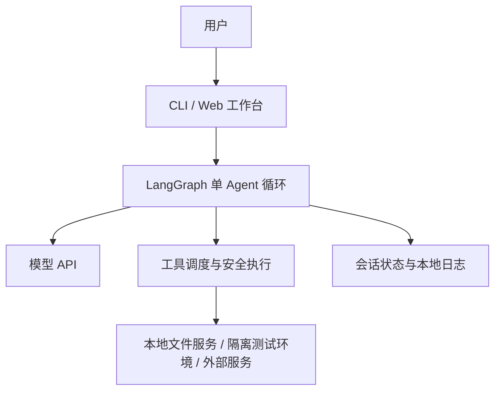
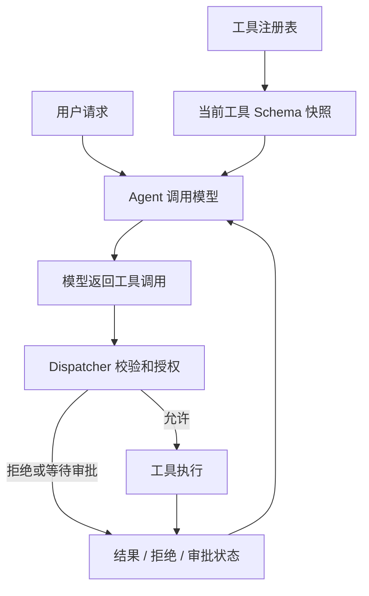

# SecureAgent Harness

SecureAgent Harness（SA）是一个面向通用任务的安全增强型自主智能体项目。当前版本提供单 Agent 对话、模型工具调用、工作区约束和可选的隔离测试环境。

## 环境

- Python 3.10 或更高版本，使用 [uv](https://docs.astral.sh/uv/) 管理依赖。
- 支持 Chat Completions 和 Tool Calling 的模型服务。
- 使用 Web 工作台时需要 Node.js 和 npm。
- 使用隔离测试环境时需要 Docker Desktop 和本地测试镜像。

## 安装与运行

在项目根目录安装依赖，复制 `.env.example` 为 `.env`，并填写模型配置：

```powershell
uv sync
Copy-Item .env.example .env
```

```dotenv
SA_API_KEY=你的模型服务密钥
SA_MODEL=你的模型名称
# 使用 OpenAI 默认地址时留空；其他兼容服务填写 API 基础地址。
SA_BASE_URL=
```

`.env` 包含本地凭据，已加入 Git 忽略规则。启动 CLI：

```powershell
uv run python main.py --workspace G:\你的工作区
```

输入 `exit` 或 `quit` 结束交互。也可以直接传入一次性请求：

```powershell
uv run python main.py --workspace G:\你的工作区 --prompt '介绍这个项目'
```

启动 Web 工作台时，在两个终端分别运行：

```powershell
# 终端 1：启动本地 API
uv run python main_web.py
```

```powershell
# 终端 2：启动前端
cd frontend
npm ci
npm run dev
```

浏览器访问 Vite 输出的地址，通常为 `http://127.0.0.1:5173`；API 默认监听 `127.0.0.1:8000`。当前本地 API 不提供用户身份认证，请勿将其暴露给不受信任的网络或用户。

## 测试

在包含 `tests/` 的完整开发仓库中运行：

```powershell
uv run python -m unittest discover -s tests -v
```

公开的精简版本不包含测试脚本，上述测试命令需要完整开发仓库。需要隔离测试环境时，在项目根目录构建镜像：

```powershell
docker build -f docker/Dockerfile.p0 -t secureagent-p0-tests:local .
uv run python main.py --workspace G:\你的工作区 --sandbox-image secureagent-p0-tests:local
```

## 项目架构



- **交互层**：CLI 和 Web 工作台接收请求、呈现回复及执行状态。
- **Agent 层**：LangGraph `StateGraph` 管理模型与工具之间的循环，并限制执行步数和调用次数。
- **模型层**：通过兼容 OpenAI Chat Completions 的接口发送消息和工具 Schema，接收模型回复及工具调用请求。
- **执行层**：工具注册表管理工具定义，Dispatcher 校验和分发调用；策略与工作区组件负责执行端的权限及路径检查。
- **状态层**：保存本地会话日志及相关状态，供 Web 会话恢复和执行记录展示使用。

RAG、MCP 及跨系统通用的幂等执行和故障恢复仍是后续目标，当前版本不宣称已经完整实现。

## 工具执行架构



模型根据工具 Schema 提出调用，可信执行端再解析和验证参数、检查工具注册状态，并依据策略和工作区约束决定是否执行。需要用户审批的操作会返回待审批状态；审批与执行前还会检查相应的参数、资源及状态。工具结果返回 Agent 循环，供后续模型调用使用。

文件操作中，部分工具通过 Cordis 提供的 `ctx.fs` 服务访问本地文件系统 Provider；部分工具仍有独立的本地实现。该接口目前不代表已支持远程 Provider 或运行时切换。可选的测试执行使用 Docker 会话沙箱；宿主工作区约束与容器隔离是不同的边界。

文件、网页和工具输出均按不可信内容处理；模型判断和提示词不能替代执行端授权。对可能产生副作用且结果不明确的操作，系统返回未知状态，需先核对实际结果，不应盲目重试。当前本地路径检查不构成对其他本机进程或多用户环境的完整隔离。
